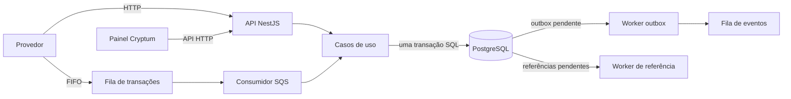

# Cryptum

**Cryptum é um serviço de carteiras e processamento financeiro para operações de
apostas.** Ele recebe transações de diferentes provedores, aplica as regras de
negócio de forma segura sob concorrência e mantém o saldo da carteira coerente
com um histórico financeiro imutável.

O foco do projeto é a correção do dinheiro e dos efeitos persistidos: a mesma
operação não pode debitar duas vezes, duas apostas simultâneas não podem gastar
o mesmo saldo, uma reversão precisa corresponder à transação original e todo
saldo precisa poder ser explicado por lançamentos auditáveis. O serviço expõe
uma API HTTP, aceita transações por fila, publica eventos de integração e inclui
um painel web para consultar carteiras.

> **Em uma frase:** Cryptum transforma solicitações de transação potencialmente
> duplicadas, concorrentes ou fora de ordem em mudanças de saldo atômicas,
> rastreáveis e idempotentes.

## O problema que o projeto resolve

Integrações financeiras não entregam sempre uma solicitação uma única vez nem
na ordem ideal. Um provedor pode repetir uma chamada depois de perder a resposta;
uma fila pode entregar a mesma mensagem novamente; uma reversão pode chegar
antes da transação a que se refere; e solicitações concorrentes podem tentar
consumir o mesmo saldo.

Tratar cada pedido como uma simples atualização de saldo deixa brechas: um retry
pode duplicar o efeito, uma corrida pode levar a saldo negativo e um ajuste
direto no saldo pode apagar a explicação de como ele foi formado. Cryptum trata
cada movimento como uma transação de negócio registrada e aplica o efeito na
carteira, no histórico financeiro e na publicação de eventos como uma unidade
atômica.

## Escopo funcional

O sistema oferece:

- abertura de carteiras vinculadas a um jogador e a uma moeda;
- processamento de apostas e demais transações de wagering;
- consulta de carteira, transação e histórico de lançamentos;
- reconciliação entre o saldo armazenado e o saldo reconstruído pelo histórico;
- entrada de transações tanto por HTTP quanto por fila FIFO;
- publicação assíncrona de eventos por meio do padrão transactional outbox;
- observabilidade por health checks e métricas no formato do Prometheus;
- painel web para criar e consultar carteiras, percorrer lançamentos e solicitar
  reconciliação.

O projeto não implementa autenticação. Essa é uma decisão explícita de escopo,
não uma propriedade de segurança: o resolvedor de identidade atual confia no
`providerId` enviado no payload. O guard e a porta de identidade estão
preparados para a integração futura com um provedor de identidade, mas não
substituem autenticação efetiva. O desenho e esse limite estão detalhados em
[`docs/ARCHITECTURE.md`](./docs/ARCHITECTURE.md).

## Modelo de negócio

### Carteira e dinheiro

Uma carteira pertence a um jogador e opera em uma moeda. Seu saldo é armazenado
para leitura eficiente, mas não é a única fonte de explicação financeira: cada
alteração relevante produz um lançamento associado à transação que a causou.

O domínio representa dinheiro com o tipo `Money`, baseado em aritmética decimal.
Valores monetários trafegam como strings decimais, por exemplo `"25.00"`, e são
persistidos em colunas `numeric(20,2)`. O contrato aceita até duas casas
decimais, exige moeda em formato ISO de três letras e não usa ponto flutuante
binário para calcular saldos. Valores negativos são rejeitados na entrada; a
aritmética interna pode representar valores negativos quando isso é necessário
para demonstrar uma divergência de reconciliação.

Uma carteira pode começar com saldo zero ou com saldo inicial positivo. Quando
há saldo inicial, a criação da carteira, a transação interna `OPENING` e o
lançamento `CREDIT` correspondente são persistidos juntos. `OPENING` é interno
e não pode ser enviado por provedor.

### Tipos de transação

| Tipo | Efeito financeiro | Referência |
|---|---|---|
| `BET` | Débito na carteira | Não |
| `WIN` | Crédito na carteira | Não |
| `LOSS` | Registra o resultado, sem alterar o saldo | Não |
| `REFUND` | Crédito de estorno | Exige uma `BET` processada |
| `ROLLBACK` | Inverte a direção financeira da transação referenciada | Exige uma referência reversível |
| `OPENING` | Crédito inicial, criado somente pelo próprio serviço | Interna |

Uma transação de reversão precisa pertencer ao mesmo provedor, jogador,
carteira, rodada e moeda da transação referenciada; a referência precisa estar
processada e ser reversível; e o valor deve coincidir. `REFUND` só reverte uma
aposta. `ROLLBACK` pode reverter uma aposta, um ganho ou um reembolso, e inverte
a direção do lançamento original. O banco também impede a aplicação duplicada
de uma mesma reversão do mesmo tipo.

Os principais estados são:

| Estado | Significado |
|---|---|
| `PENDING` | Transação aceita para validação e processamento |
| `PENDING_REFERENCE` | Reversão recebida antes da transação que referencia |
| `PROCESSED` | Transação aplicada; pode ou não ter alterado o saldo |
| `REJECTED` | Solicitação conhecida, mas recusada por uma regra ou referência inválida |
| `FAILED` | Estado previsto para falha permanente auditável; não é alcançado pelo fluxo atual |

Rejeições de negócio são resultados explícitos, persistidos com um `failureCode`
estável, e não exceções opacas. Exemplos incluem saldo insuficiente, moeda
incompatível, referência inexistente, referência ainda não processada e
tentativa de reversão duplicada.

## Como o processamento mantém a consistência

### Saldo materializado e histórico imutável

O saldo atual da carteira é o **saldo materializado**: uma projeção mantida para
que consultas não precisem somar todo o histórico a cada leitura. O histórico
financeiro é formado por lançamentos append-only. Cada lançamento registra:

- carteira e transação de origem;
- direção (`DEBIT` ou `CREDIT`) e valor;
- saldo imediatamente antes e depois do movimento;
- instante de criação.

O banco valida que valores e saldos sejam válidos, que um débito subtraia o
valor e um crédito o some, e que o saldo após o movimento não fique negativo.
Há unicidade para impedir mais de um lançamento por transação e a migration
remove permissões de atualização e remoção do histórico. Portanto, corrigir um
erro não significa reescrever o passado: significa registrar uma nova operação
válida ou investigar a divergência.

### Atomicidade e concorrência

Cada operação financeira roda dentro de uma unidade de trabalho vinculada a
uma transação SQL. A carteira é bloqueada com `SELECT ... FOR UPDATE` antes das
decisões que possam afetá-la. Assim, duas operações concorrentes sobre a mesma
carteira são serializadas pelo PostgreSQL; carteiras distintas podem progredir
em paralelo.

Na mesma transação SQL são coordenados, conforme o caminho, o registro da
transação, a alteração do saldo, o lançamento financeiro, a deduplicação de
entrada e os eventos pendentes do outbox. Se qualquer escrita falhar, o banco
reverte o conjunto, em vez de deixar saldo e histórico em estados diferentes.

O domínio não depende do NestJS ou do MikroORM. Os casos de uso dependem de
portas, enquanto a infraestrutura implementa persistência, relógio,
identificadores, mensageria e métricas. Mappers explícitos reidratam os
agregados a partir dos modelos de persistência; consultas de leitura retornam
projeções próprias, sem reconstruir agregados desnecessariamente.

### Idempotência em duas camadas

Na API, `Idempotency-Key` identifica a operação e é obrigatório ao submeter uma
transação. O payload de negócio é canonicalizado e recebe um hash SHA-256; a
representação monetária é normalizada, de modo que `"25.0"` e `"25.00"` sejam
equivalentes. Repetir a mesma chave e o mesmo conteúdo não reaplica o efeito
financeiro: devolve a transação registrada e, quando houve lançamento, o saldo
após o movimento original. Reutilizar a chave com conteúdo diferente é
conflito, não uma nova transação.

Há também uma restrição única sobre `(provider_id, external_transaction_id)`,
que protege a identidade externa da transação. No caminho de filas, o inbox
registra `(consumer_name, message_id)` na mesma transação SQL do efeito
financeiro. Inbox e idempotência têm papéis complementares: o primeiro registra
a entrega da mensagem; a segunda reconhece a operação de negócio e permite
reproduzir sua resposta correta. A deduplicação do broker, sozinha, não é
considerada uma garantia de correção.

### Transações fora de ordem

Se um `REFUND` ou `ROLLBACK` chegar antes da sua referência, o Cryptum registra
a solicitação como `PENDING_REFERENCE` e responde que ela foi aceita para
processamento posterior. Um worker agenda novas tentativas com backoff
exponencial: começa em dois segundos, cresce até o limite de cinco minutos e
expira após doze tentativas, em aproximadamente meia hora. Quando a referência
aparece, a operação volta a passar pelas validações normais; se não aparecer,
a reversão termina como `REJECTED` com `REFERENCE_NOT_FOUND`.

## Fluxo ponta a ponta



1. A entrada é validada na fronteira: formato, tipo de operação e dinheiro.
2. O caso de uso bloqueia a carteira e verifica replay, referências, moeda,
   saldo e regras de reversão.
3. O banco grava o resultado financeiro e os registros associados numa única
   transação.
4. Após o commit, a API responde ao chamador ou o consumidor confirma a mensagem.
5. O publisher lê o outbox e entrega eventos à fila de saída. Se uma entrega
   precisar ser repetida, o consumidor do evento deve tolerar entrega
   *at-least-once*.

Para filas FIFO, mensagens e eventos são agrupados pelo identificador da
carteira. Isso preserva a ordem dentro de uma carteira sem serializar todas as
carteiras do sistema. Mensagens malformadas e conflitos permanentes de
idempotência são enviados à dead-letter queue (DLQ); falhas transitórias ficam
sem confirmação e podem ser entregues novamente. A fila de entrada tem política
de redrive após cinco entregas.

## API HTTP

Dinheiro em requests e responses usa o formato
`{"amount":"25.00","currency":"BRL"}`. Identificadores de carteira, jogador e
transação são UUIDs.

### Carteiras

| Método e rota | Finalidade |
|---|---|
| `POST /wallets` | Cria uma carteira para `playerId` com `initialBalance` |
| `GET /wallets/{walletId}` | Consulta saldo, moeda, versão e datas da carteira |
| `GET /wallets/{walletId}/ledger?cursor=...&limit=50` | Consulta lançamentos em ordem decrescente |
| `POST /wallets/{walletId}/reconciliation` | Compara saldo armazenado com o saldo reconstruído pelo histórico |

Exemplo de criação:

```json
{
  "playerId": "0192f28f-5dc0-7d58-bdb2-814ad6a0f4a1",
  "initialBalance": {
    "amount": "1000.00",
    "currency": "BRL"
  }
}
```

A paginação do histórico usa cursor opaco baseado em `(created_at, id)`, em vez
de offset. A resposta contém `entries` e `nextCursor`; `nextCursor: null`
indica o fim. O limite padrão é 50 e o máximo é 100. A carteira é verificada
antes de listar para que uma carteira inexistente não seja confundida com uma
carteira sem lançamentos.

A reconciliação retorna saldo armazenado, saldo calculado, diferença, indicador
de consistência e quantidade de lançamentos verificados. Ela lê a carteira sob
bloqueio para evitar falsos alertas durante uma escrita concorrente. **Nunca
altera nem corrige o saldo**: divergências são sinalizadas para investigação.

### Transações de wagering

| Método e rota | Finalidade |
|---|---|
| `POST /wagering/transactions` | Submete uma transação de provedor |
| `GET /wagering/transactions/{transactionId}` | Consulta uma transação pelo ID interno |
| `GET /providers/{providerId}/wagering/transactions/{externalTransactionId}` | Consulta pela identidade externa do provedor |

O `POST` requer o header `Idempotency-Key`. O corpo inclui `providerId`,
`externalTransactionId`, `playerId`, `walletId`, `roundId`, `gameId`, `kind` e
`money`; `referenceExternalTransactionId` é obrigatório para `REFUND` e
`ROLLBACK`.

Exemplo de submissão:

```http
POST /wagering/transactions
Idempotency-Key: provider-a:transaction-123
Content-Type: application/json
```

```json
{
  "providerId": "provider-a",
  "externalTransactionId": "transaction-123",
  "playerId": "0192f28f-5dc0-7d58-bdb2-814ad6a0f4a1",
  "walletId": "0192f291-27dd-7d3f-8071-5f8685deef37",
  "roundId": "round-987",
  "gameId": "fortune-chimp",
  "kind": "BET",
  "money": {
    "amount": "25.00",
    "currency": "BRL"
  }
}
```

O status HTTP comunica o resultado de processamento:

| Situação | Resposta |
|---|---|
| Transação processada ou replay idempotente | `200` |
| Carteira criada | `201` |
| Reversão aceita, aguardando referência | `202` |
| Payload inválido ou cursor inválido | `400` |
| Carteira ou transação inexistente | `404` |
| Chave de idempotência conflitante ou carteira duplicada | `409` |
| Transação rejeitada por regra de negócio | `422`, com `failureCode` |
| Falha transitória de infraestrutura | `503`, com indicação de retry |
| Falha permanente ou inesperada de infraestrutura | `500` |

### Saúde e métricas

| Método e rota | O que informa |
|---|---|
| `GET /health/live` | Se o processo está vivo; não consulta dependências |
| `GET /health/ready` | Se PostgreSQL e SQS estão alcançáveis, com latência e estado por sonda |
| `GET /metrics` | Métricas em formato de exposição do Prometheus |

Liveness e readiness são intencionalmente diferentes: um processo pode estar
vivo e ainda não estar pronto para receber trabalho. A readiness executa sondas
independentes com timeout para cada dependência.

## Painel web

O frontend **Cryptum** é uma interface operacional focada em carteiras:

- visão geral com estado da API e acesso às operações de carteira;
- criação de carteira para um jogador, com saldo e moeda iniciais;
- consulta de carteira pelo UUID;
- visualização do saldo, versão, jogador e lançamentos recentes;
- navegação paginada pelo histórico;
- atualização dos dados e solicitação explícita de reconciliação.

O painel é um cliente da API, não uma segunda implementação das regras
financeiras. A aplicação de transações de wagering continua sendo oferecida
pelos endpoints HTTP e pela fila; o frontend não apresenta uma tela de
submissão/gestão de apostas.

## Arquitetura e responsabilidades

O backend é organizado para manter decisões financeiras separadas dos detalhes
de transporte e persistência:

| Área | Responsabilidade |
|---|---|
| `src/domain` | `Money`, carteira, transação, lançamentos, regras e eventos de domínio |
| `src/application` | Casos de uso, portas e coordenação das operações |
| `src/api` | Controllers HTTP, DTOs, guard de provedor e tradução de erros |
| `src/infrastructure/database` | MikroORM, schema, migrations, queries, mappers e unidade de trabalho |
| `src/infrastructure/messaging` | Cliente SQS, consumidor, publisher e workers |
| `src/health` | Sondas de disponibilidade das dependências |
| `src/observability` | Instrumentação e exposição de métricas |
| `web/src` | Painel React e cliente HTTP da API |
| `test` | Testes de integração, concorrência, schema e mensageria |

O PostgreSQL é a autoridade transacional para carteiras, transações,
lançamentos, inbox e outbox. SQS transporta as solicitações assíncronas e os
eventos de integração. O ambiente local usa LocalStack para emular SQS; essa
emulação não altera o papel do PostgreSQL como autoridade do estado financeiro.

O outbox evita o problema de confirmar uma alteração no banco e perder o evento
correspondente: transação financeira e evento pendente são gravados juntos; um
worker publica o evento depois. Se a publicação se repetir após uma falha, a
entrega é *at-least-once*, não exatamente uma vez. O `eventId` permite
deduplicação na fronteira consumidora, e o inbox oferece proteção transacional
para as mensagens de entrada deste serviço.

## Persistência e invariantes no banco

As migrations criam as seguintes estruturas principais:

| Tabela | Conteúdo |
|---|---|
| `wallets` | Carteira, moeda, saldo materializado e versão |
| `wager_transactions` | Identidade, payload, estado e referência de cada transação |
| `wallet_ledger_entries` | Histórico imutável de débitos e créditos |
| `inbox_messages` | Deduplicação persistente das mensagens recebidas |
| `outbox_messages` | Eventos a publicar e metadados de retry |

Além das validações do domínio, o schema protege invariantes com `CHECK`,
índices únicos e chaves estrangeiras. Entre elas: saldo não negativo, moeda e
direção válidas, valor positivo, coerência aritmética entre saldos antes/depois,
unicidade da chave de idempotência, unicidade da identidade externa do provedor,
unicidade do lançamento por carteira/transação e prevenção de reversão duplicada.
As migrations são versionadas e escritas explicitamente para que a estrutura
financeira seja revisável, testável e controlada.

## Stack e verificações

- **Bun 1.x** executa a aplicação TypeScript e o test runner.
- **NestJS 11** organiza controllers, módulos, injeção e ciclo de vida dos workers.
- **TypeScript em modo estrito** verifica os contratos entre domínio, aplicação
  e infraestrutura.
- **PostgreSQL 17** fornece transações, locks, constraints e armazenamento decimal.
- **MikroORM 7** integra o PostgreSQL; os mappers mantêm os agregados
  independentes das entidades de persistência.
- **AWS SQS** é o transporte FIFO, emulado localmente por **LocalStack**.
- **React 19, Vite e TypeScript** compõem o painel web.
- **decimal.js** sustenta a aritmética monetária exata no domínio.

A suíte combina testes unitários de domínio e casos de uso com testes de
integração contra PostgreSQL/SQS. Ela cobre, entre outros aspectos, regras de
dinheiro e reversão, corrida por saldo, execução com múltiplas instâncias,
restrições do schema, idempotência, referências pendentes, reconciliação,
publisher do outbox, consumidor e saúde das dependências. Os testes que exercitam
infraestrutura são separados dos que não dependem dela.

## Decisões e limites conhecidos

- A escala monetária é fixa em duas casas decimais. Suportar moedas com outra
  escala exigiria uma regra de escala por moeda.
- A autenticação ainda não foi implementada; a identidade do provedor confiada
  no payload não deve ser interpretada como autenticação em produção.
- O estado `FAILED` e a transição de domínio correspondente existem, mas o fluxo
  atual não os alcança: o processamento financeiro é atômico, e falhas de
  infraestrutura abortam a transação.
- A reconciliação detecta e reporta divergências; não tenta repará-las.
- O transporte de eventos é *at-least-once*. Consumidores de eventos devem
  tolerar repetição.
- A interface web cobre a operação de carteiras, não todas as capacidades
  administrativas nem a gestão de apostas.

As alternativas avaliadas, evidências de validação e trade-offs de cada decisão
estão descritos em [`docs/ARCHITECTURE.md`](./docs/ARCHITECTURE.md). Esse
documento complementa este README com o registro técnico detalhado, sem
substituir a visão funcional apresentada aqui.
